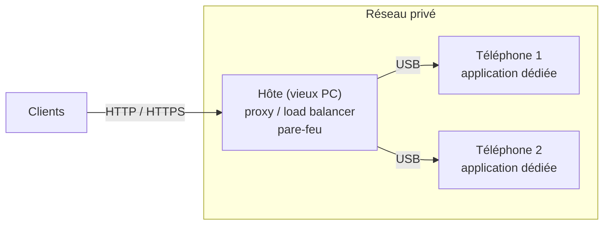

# Datacenter smartphones — réseau et logiciel des nœuds

*Compte rendu du 11 novembre 2026*

## En bref

Pour un premier prototype avec des téléphones de récupération, l'approche du POC est envisageable : **un hôte (vieux PC) relié aux téléphones en USB, avec une application Android dédiée sur l'Android d'origine**. Elle reste à valider par des mesures de longue durée et sur plusieurs téléphones.

## Réseau

| Option | Avantages | Inconvénients | Verdict |
|---|---|---|---|
| Wi-Fi | Coût nul | Instable ; environ 20-30 appareils par point d'accès ; téléphones exposés | Tests seulement |
| Hôte + USB, `adb forward` | Marche sur tout Android ; téléphones isolés ; testé | adb n'est pas un outil de production ; l'hôte est un point de défaillance | **Prototype** |
| Hôte + USB, modem USB | Vraie interface réseau, sans adb | ⚠️ Probables conflits d'adresses (même sous-réseau sur chaque téléphone) | À tester |
| USB-Ethernet par téléphone | Switch standard, facile à agrandir | ⚠️ Compatibilité non vérifiée (OTG, pilote) ; environ 20-30 CHF par téléphone | En réserve |

## Logiciel sur le téléphone

| Solution | Avantages | Inconvénients |
|---|---|---|
| **Linux natif** (postmarketOS…) | Vrai Linux, outils standard ; correctifs de sécurité à jour | Peu de modèles supportés, souvent partiellement ; flash manuel par téléphone |
| **Termux** | Gratuit, sans root ; tout langage ; rien à compiler | Installation manuelle par téléphone ; Android peut tuer l'appli ; pas de redémarrage automatique |
| **Application Android dédiée** | Une APK installée et mise à jour sur tous les téléphones en une commande ; tourne en permanence et redémarre seule ; accès aux API Android sans root | Code à maintenir ; langages et bibliothèques fixés à la compilation |

## Ce que le POC a montré (Galaxy A5 2016, Android 7.0)

- **Vérifié** : une application dédiée sert Flask et Django en HTTP et HTTPS, sans root, derrière le PC. Elle tient environ 40 requêtes par seconde (une seule mesure) et utilise environ 86 Mo de mémoire.
- **À valider** : stabilité écran éteint et après un reboot, comparaison avec Termux, plusieurs téléphones par hôte.

## Conclusion

Pour une première version, l'approche du POC est envisageable. Elle fonctionne sur un vrai téléphone, sans root ni flash, avec du matériel de récupération. Elle s'adapte aussi à un parc hétérogène, car elle n'exige aucun modèle particulier.

Ce n'est pas encore une solution validée :
- Les résultats viennent d'un seul téléphone et de tests courts.
- Le lien `adb forward` convient au prototype, pas à la production ; son remplaçant (modem USB) reste à tester.
- Les vieux Android ne reçoivent plus de correctifs de sécurité : les téléphones doivent rester isolés derrière l'hôte.
- L'alimentation des téléphones n'est pas encore traitée : c'est le prochain problème à régler.

Pour la suite, une alternative sérieuse est à garder ouverte : un parc homogène (un ou deux modèles bien supportés) sous Linux natif, avec des correctifs de sécurité et des outils standard.
