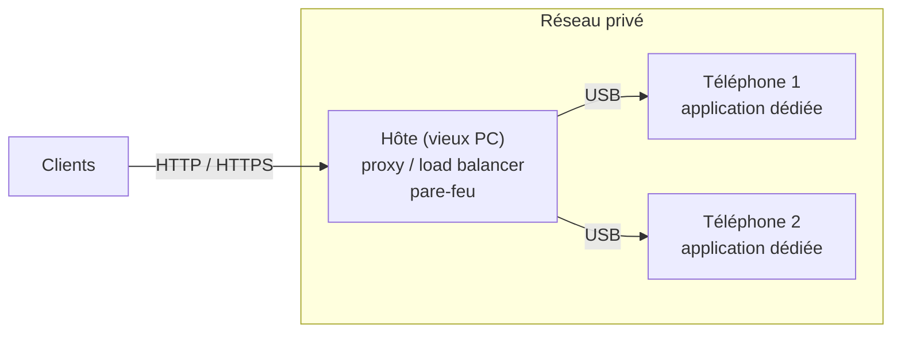
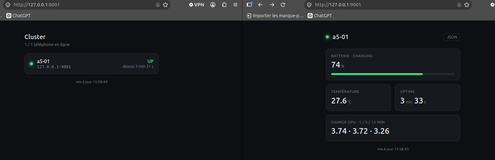

# Datacenter smartphones — réseau et logiciel des nœuds

*Compte rendu du 11 novembre 2026*

## Options réseau proposées

| Option | Avantages | Inconvénients |
|---|---|---|
| **Wi-Fi** | Coût nul, rien à câbler | Instable ; environ 20-30 appareils par point d'accès ; téléphones joignables par tout le réseau |
| **Hôte + smartphones en USB** | Marche sur tout Android ; téléphones isolés derrière l'hôte | L'hôte est un point de défaillance ; nombre de téléphones limité par hôte |
| **Interface LAN par téléphone** (adaptateur USB-Ethernet) | Switch standard, facile à agrandir, pas d'hôte intermédiaire | ⚠️ Compatibilité non vérifiée (OTG, pilote) ; environ 20-30 CHF par téléphone |

## Proposition la plus viable : hôte + smartphones en USB

Pour des téléphones de récupération, c'est l'option qui paraît la plus viable :

- **Compatible avec tous les téléphones** : le port USB existe sur chaque modèle, même ancien, sans adaptateur ni support OTG.
- **Peu de matériel** : des câbles et des hubs USB, pas d'équipement par téléphone.
- **Sécurisée** : les téléphones sont sur un réseau privé ; seul l'hôte est exposé.
- **Gestion centralisée** : l'hôte déploie, surveille et redémarre les téléphones.
- **Modulaire** : une unité = un hôte et ses téléphones ; on agrandit en ajoutant des unités.
- **Donne un rôle aux vieux PC**, qui servent d'hôtes.
- **Déjà testée** sur le prototype.

Deux façons de faire passer le trafic par le câble USB :

| Variante | Avantages | Inconvénients | Statut |
|---|---|---|---|
| **ADB** (`adb forward`) | Marche sur tout Android avec le débogage USB ; rien à configurer sur le téléphone | Outil de développement, pas de production ; redirections à recréer après chaque rebranchement | Testé sur le prototype |
| **Modem USB** (tethering) | Vraie interface réseau, sans dépendre d'adb | ⚠️ Probables conflits d'adresses (même sous-réseau sur chaque téléphone) ; ⚠️ se désactiverait au redémarrage | À tester |

## Logiciel sur le téléphone

| Solution | Avantages | Inconvénients |
|---|---|---|
| **Linux natif** (postmarketOS…) | Vrai Linux, outils standard ; correctifs de sécurité à jour | Peu de modèles supportés, souvent partiellement ; flash manuel par téléphone |
| **Termux** | Gratuit, sans root ; tout langage ; rien à compiler | Installation manuelle par téléphone ; Android peut tuer l'appli ; pas de redémarrage automatique |
| **Application Android dédiée** | Une APK installée et mise à jour sur tous les téléphones en une commande ; tourne en permanence et redémarre seule ; accès aux API Android sans root | Code à maintenir ; langages et bibliothèques fixés à la compilation |

La proposition la plus viable est l'application dédiée : elle se déploie sur tous les téléphones d'un coup et tourne sans intervention. Termux reste utile pour les tests.

## Ce que le POC a montré (Galaxy A5 2016, Android 7.0)

*Prototype en marche, 10 novembre 2026 (version Termux). À gauche, le tableau de bord du cluster sur le PC (1 téléphone en ligne sur 1). À droite, la page du nœud `a5-01` : batterie, température, uptime et charge CPU.*

- **Vérifié** : une application dédiée sert Flask et Django en HTTP et HTTPS, sans root, derrière le PC. Elle tient environ 40 requêtes par seconde (une seule mesure) et utilise environ 86 Mo de mémoire.
- **À valider** : stabilité écran éteint et après un reboot, comparaison avec Termux, plusieurs téléphones par hôte.

## Conclusion

Pour une première version, l'approche du POC est envisageable. Elle fonctionne sur un vrai téléphone, sans root ni flash, avec du matériel de récupération. Elle s'adapte aussi à un parc hétérogène, car elle n'exige aucun modèle particulier.

Ce n'est pas encore une solution validée :
- Les résultats viennent d'un seul téléphone et de tests courts.
- Le lien `adb forward` convient au prototype, pas à la production ; son remplaçant (modem USB) reste à tester.
- Les vieux Android ne reçoivent plus de correctifs de sécurité : les téléphones doivent rester isolés derrière l'hôte.
- L'alimentation des téléphones n'est pas encore traitée : c'est le prochain problème à régler.

Pour la suite, une alternative sérieuse est à garder ouverte : un parc homogène (un ou deux modèles bien supportés) sous Linux natif, avec des correctifs de sécurité et des outils standard.
